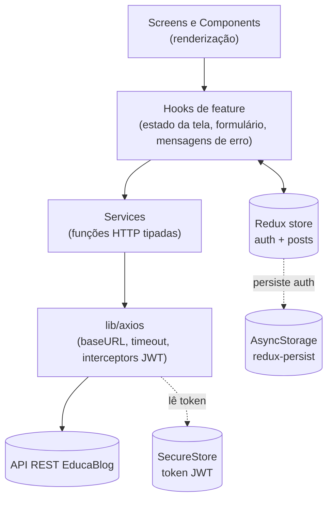
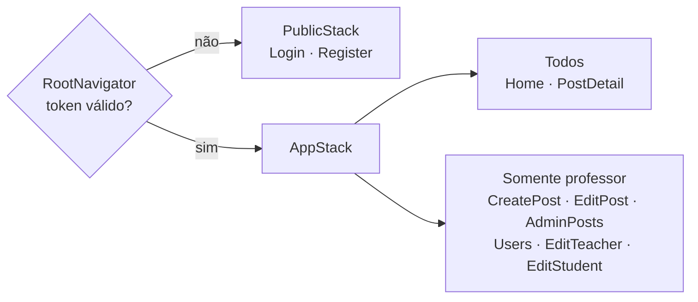

# EducaBlog Mobile

API para blogging dinâmico entre professores e alunos.

Projeto da **FIAP PosTech Full Stack Development, Fase 4 (Tech Challenge)**. Consome a mesma API REST das fases anteriores e reaproveita os contratos e a identidade visual do front-end web da Fase 3.

## Tecnologias

| Camada | Tecnologia |
|---|---|
| Mobile | React Native 0.76 · Expo SDK 52 · TypeScript (strict) |
| Navegação | React Navigation 6 (Native Stack) |
| Estado | Redux Toolkit 2 · React Redux 9 · redux-persist 6 |
| Armazenamento | expo-secure-store (token JWT) · AsyncStorage |
| HTTP | Axios 1 |
| Formulários | react-hook-form 7 · Zod 3 |
| UI | styled-components 6 · @expo/vector-icons |
| Qualidade | TypeScript (`tsc --noEmit`) · ESLint 8 |

## Começando

### Pré-requisitos

| Ferramenta | Versão | Observação |
|---|---|---|
| Node.js | **22.13.0 LTS** (recomendada) | O Metro 0.81 (Expo 52) requer `^22.13.0`. As versões 22.23+ e 24 quebram o loader CJS do Metro. |
| npm | ≥ 10 | Necessário para o bloco `overrides` do `package.json` |
| Expo Go | Compatível com a **SDK 52** | Também é possível usar emulador Android ou simulador iOS |


> O `package.json` tem um bloco `overrides` que fixa todos os pacotes `metro/*` em `0.81.0`. Sem ele, o npm resolve o Metro 0.87, que é incompatível com o Node usado no projeto. **Não remova esse bloco.**


> As lojas costumam distribuir apenas o Expo Go da SDK mais recente. Se o app acusar SDK incompatível, instale a versão do Expo Go para a SDK 52 em [expo.dev/go](https://expo.dev/go) ou rode no emulador.

### Instalação

```bash
git clone https://github.com/fiapfullstack2026/educablog-mobile.git
cd educablog-mobile

npm install
cp .env.example .env

# Cache limpo é recomendado na primeira execução
npx expo start --clear
```

Com o servidor do Expo no ar, escaneie o QR code com o Expo Go ou pressione `a` (emulador Android) ou `o` (simulador iOS).

> A API fica hospedada no Render e pode demorar a responder na primeira requisição, se estiver ociosa. Se o primeiro login exibir *"O servidor demorou para responder"*, tente de novo.

> Para emular o iOS é necessário instalar o Xcode.

### Variáveis de ambiente

| Variável | Obrigatória | Padrão | Descrição |
|---|:---:|---|---|
| `EXPO_PUBLIC_API_URL` | Não | `https://educablog.onrender.com` | URL base da API, **sem barra no final**. Para usar um back-end local, aponte para o IP da máquina na rede (ex.: `http://192.168.0.10:3000`), e não para `localhost`. |

Variáveis com prefixo `EXPO_PUBLIC_` são embutidas no bundle no build. Não coloque segredos nelas.

### Scripts

| Comando | O que faz |
|---|---|
| `npm start` | Inicia o servidor de desenvolvimento do Expo |
| `npm run android` | Inicia e abre no emulador/dispositivo Android |
| `npm run ios` | Inicia e abre no simulador iOS (somente macOS) |
| `npm run web` | Inicia a versão web (não é o alvo principal) |

## Guia de uso

### Primeiro acesso

1. Na tela de login, toque em **Cadastrar usuário**.
2. Informe usuário, senha e confirmação, e escolha o perfil: **Sou aluno** ou **Sou professor**.
3. Após o cadastro, volte ao login e entre com as credenciais criadas.

O perfil vem dentro do token JWT e define quais telas o app mostra.

### Como aluno

- **Home**: lista todos os posts, com a disciplina identificada por cor e ícone. Puxe a lista para baixo para atualizar.
- **Busca**: digite na barra de pesquisa. A busca é feita na API (título e conteúdo, sem diferenciar maiúsculas) depois de uma pequena pausa na digitação.
- **Leitura**: toque em um post para abrir o conteúdo completo.
- **Sair**: ícone de logout no canto superior direito.

### Como professor

O professor tem tudo o que o aluno tem e, no cabeçalho da Home, mais três ações:

| Ícone | Ação | O que permite |
|---|---|---|
| Lista | **Gerenciar posts** | Ver todos os posts com atalhos de editar e excluir, e criar um novo |
| ➕ | **Criar post** | Formulário com título, disciplina, professor e conteúdo |
| Grupo de pessoas | **Usuários** | Abas **Professores** e **Alunos**, com edição e exclusão |

### Sessão

- A sessão sobrevive ao fechamento do app.
- A validade do token é verificada ao abrir o app e a cada 30 segundos. Quando o token expira, o app volta para o login.
- Se a API recusar o token (HTTP 401), o app faz logout automaticamente.

## Arquitetura

### Visão geral

O app é organizado **por feature**, e dentro de cada feature **por camada**. A regra de dependência é de cima para baixo: telas não chamam a API diretamente, e serviços não conhecem React.



| Camada | Responsabilidade | Exemplo |
|---|---|---|
| **Screen** | Compor a tela, ligar navegação e hook. Sem regra de negócio. | `CreatePostScreen` |
| **Component** | UI reutilizável dentro da feature ou do app | `PostForm`, `PostCard` |
| **Hook** | Estado da tela, `react-hook-form` + Zod, chamada ao service, tradução de erros HTTP em mensagens | `useCreatePost`, `usePosts` |
| **Service** | Uma função por endpoint, tipada, sem estado | `postsService.createPost` |
| **Schema / Types** | Validação (Zod) e contratos da API | `postSchema`, `post.types` |

### Estrutura de pastas

```
educablog-mobile/
├── App.tsx                  # Providers: Redux, PersistGate, Theme, SafeArea
├── app.json                 # Configuração do Expo (nome, ícones, bundle id)
├── babel.config.js          # Alias @/ → src/
└── src/
    ├── components/          # Design system: Button, Input, FormField, Card, Feedback...
    ├── features/
    │   ├── auth/            # Login, registro, decodificação do JWT, logout
    │   ├── posts/           # Home, busca, leitura, CRUD e painel de posts
    │   ├── teachers/        # Listagem, edição e exclusão de professores
    │   ├── students/        # Listagem, edição e exclusão de alunos
    │   └── users/           # Tela com abas que agrupa professores e alunos
    ├── hooks/               # Hooks genéricos (useDebounce)
    ├── lib/axios.ts         # Cliente HTTP único da aplicação
    ├── navigation/          # RootNavigator, stacks, tipos de rota, guarda TeacherOnly
    ├── store/               # configureStore, authSlice, hooks tipados
    ├── styles/              # Tema (tokens de cor, espaçamento, tipografia)
    └── types/               # Envelopes de resposta da API
```

Anatomia de uma feature (nem toda feature tem todas as pastas):

```
features/posts/
├── screens/      # Uma tela por rota
├── components/   # UI da feature
├── hooks/        # Lógica de tela
├── services/     # Acesso à API
├── schemas/      # Validação Zod
├── types/        # Contratos da API
├── constants/    # Ex.: lista de disciplinas e aliases
├── utils/        # Ex.: conversão de HTML em texto
└── postSlice.ts  # Estado global da feature, quando necessário
```

### Navegação e controle de acesso



O controle de acesso tem três camadas :

1. **Rotas condicionais**: o `AppStack` só registra as telas de professor quando `isTeacher` é verdadeiro. Para um aluno, essas rotas não existem.
2. **Guarda de tela**: o componente `TeacherOnly` bloqueia a renderização caso uma tela restrita seja alcançada por outro caminho.
3. **API**: o back-end valida o perfil e responde `403`. Os hooks traduzem esse status em mensagem para o usuário.

> O perfil é lido do payload do JWT **sem verificar a assinatura**. Isso só decide o que a interface mostra.


### Integração com a API

Todo acesso passa pela instância única em `src/lib/axios.ts`: `baseURL` vinda do ambiente, timeout de 15 s, `Authorization: Bearer` injetado por interceptor e tratamento central do `401`.

| Método | Endpoint | Uso no app | Perfil |
|---|---|---|---|
| `POST` | `/user/signin` | Login | Público |
| `POST` | `/user/register` | Cadastro | Público |
| `GET` | `/posts` | Lista da Home | Autenticado |
| `GET` | `/posts/search?q=` | Busca (termo escapado para regex) | Autenticado |
| `GET` | `/posts/:id` | Leitura e edição | Autenticado |
| `POST` | `/posts` | Criar post | Professor |
| `PUT` | `/posts/:id` | Editar post | Professor |
| `DELETE` | `/posts/:id` | Excluir post | Professor |
| `GET` | `/user?isTeacher=true\|false` | Listas de professores e alunos | Professor |
| `GET` | `/user/:id` | Carregar usuário para edição | Professor |
| `PUT` | `/user/:id` | Editar usuário | Professor |
| `DELETE` | `/user/:id` | Excluir usuário | Professor |

A documentação completa está no [Swagger do back-end](https://educablog.onrender.com/docs/).

**Tratamento de erros:** cada hook tem uma função `getErrorMessage` que converte o erro do Axios em mensagem em português, distinguindo timeout, falta de conexão, `401`, `403`, `404` e a mensagem enviada pela API.


## Links

- API (Swagger): https://educablog.onrender.com/docs/
- Repositório do back-end (Fase 2): https://github.com/fiapfullstack2026/educablog
- Repositório do front-end web (Fase 3): https://github.com/fiapfullstack2026/educablog-frontend
